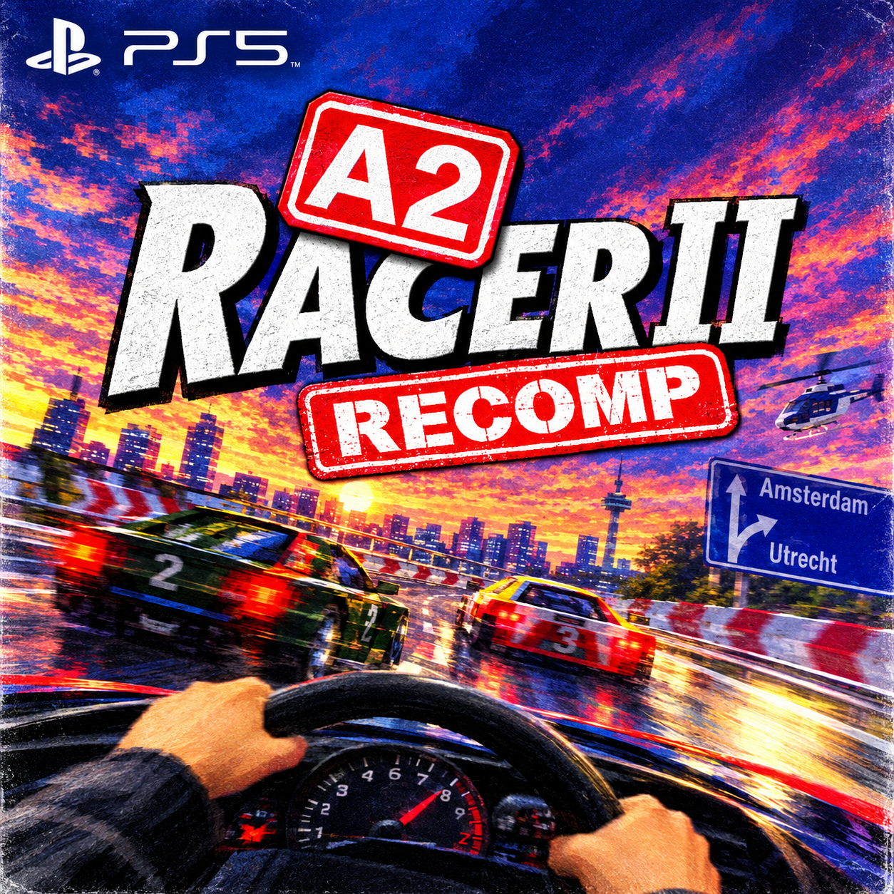

<p align="center"></p>

# A2 Racer II for the PlayStation 5

A port of [a2racer2-re](https://github.com/berobloom/a2racer2-re), berobloom's C reimplementation of the 1998
Dutch racer A2 Racer II, to native PS5 homebrew. It runs as an installed title (`PPSA69428`) and draws with
fixed-function OpenGL on the PS5 OpenGL SDK's Compatibility profile.

You need your own copy of the game: the title reads the game's files from your disc image. No game data is
included.

## What works

Tested on one console (FW 13.60, ShadowMountPlus):

- The menu, a career, races with sound and the intro video
- Back from a race to the menu, and closing the game from the menu
- The DualSense, the touchpad as the menu's mouse, and the PS5's keyboard for a player's name
- The light bar flashing blue and red while a police siren is heard

## Installing

1. Download `A2Racer2-PS5-<version>.zip` from the [releases](https://github.com/Marice/a2-racer-2-ps5/releases)
   and unpack the `PPSA69428` folder to `/data/homebrew/` on the console (ShadowMountPlus installs it).
2. Put your disc image of **A2 Racer II (Netherlands) (v1.01)**, the `.bin` and its `.cue`, in
   `/data/homebrew/PPSA69428/dump/`.
3. Start the title. The first start copies the game's files from the disc image to the title folder's `data/`
   folder, with a progress bar; that happens once. Afterwards the disc image may be removed.

The disc image is read as a raw CD image (2352-byte sectors, the usual `.bin`/`.cue` dump). If the title finds no
image, it says so on screen.

## Controls

**Menu**

| Button | Does |
| --- | --- |
| Touchpad | The mouse: slide a finger to move the pointer, press the touchpad to click |
| Left stick | Moves the pointer too |
| R2 | Clicks too |
| D-pad up/down | The next or previous button |
| Cross, Options | Choose (Enter) |
| Circle | Back / no |

Making a new player opens the PS5's keyboard (up to 8 characters).

**Race**

| Button | Does |
| --- | --- |
| Left stick | Steer (analog) |
| R2 / L2 | Throttle / brake (analog) |
| Cross, R1 | Turbo |
| Square | Handbrake |
| Triangle | Next camera |
| L1 (hold) | The other view |
| R3 | Horn |
| Options | "Stop the race?" (Cross yes, Circle no) |
| Touchpad press | Pause |
| Cross | Start the race; continue after the finish |

## Building

On Linux, with clang 18:

```sh
tools/setup-source.sh                                   # upstream at the pinned commit, with patches/ applied
python3 tools/make-backgrounds.py art/background.jpg sce_sys   # pic0.dds, pic1.dds (needs Pillow and etcpak)
HOST_CC=clang-18 ./build.sh                             # pkg/PPSA69428
tools/package.sh                                        # dist/A2Racer2-PS5-<version>.zip
```

`build.sh` fetches PacBrew's PS5 SDL2 and the PS5 OpenGL SDK 1.0.2 (`tools/setup-pacbrew.sh`,
`tools/setup-glsdk.sh`, checksums checked) and expects the payload SDK at `/opt/ps5-payload-sdk`. It takes
`ps5-native-tool`, the module stubs and `libc.prx` from a sibling `stk-ps5` checkout. After changing the
sources in `src-upstream/`, `tools/save-patch.sh` writes `patches/a2racer2.patch` again.

`tools/extract-disc.py` extracts the game's files from a disc image on a PC, for testing upstream there.

## How the port works

| Part | What it does |
| --- | --- |
| `patches/a2racer2.patch` | Upstream's changes: the menu starts each race as a call (upstream's web path), `GL_QUADS` drawn as triangles (much faster on the PS5), the DualSense in the race's input, the light bar hook |
| `ps5/a2_ps5_gl.c` | One EGL Compatibility context for the whole run; SDL's GL functions replaced at link time |
| `ps5/a2_ps5_input.c` | The DualSense read with `scePadRead` and turned into the keys, mouse and wheel the game knows; the PS5's keyboard through `sceImeDialog`; the light bar |
| `ps5/a2_ps5_disc.c` | Copies the game's files from the disc image's Joliet tree on the first start |
| `ps5/a2_ps5_trace.c` | Keeps SDL up between a race and the menu; logs that step |
| `ps5/ps5-*.c` | Runtime from stk-ps5: heap, paths, buffered log (`a2racer2.log` in the title folder), crash reports |

## Credits

- [berobloom](https://github.com/berobloom/a2racer2-re) for the reimplementation (BOLA licence: public domain,
  with the request to credit the authors and share changes)
- The original game by Davilex Games (1998)
- PacBrew for SDL2 on the PS5; the PS5 OpenGL SDK; ProsperoTV for the `sceImeDialog` sequence

## Licence

The port's own files (`ps5/`, `tools/`, `patches/`, the build files) are GPL-3.0-or-later (`LICENSE`). Upstream's
code keeps its BOLA licence. A2 Racer II's game data is not part of this repository or its releases.
